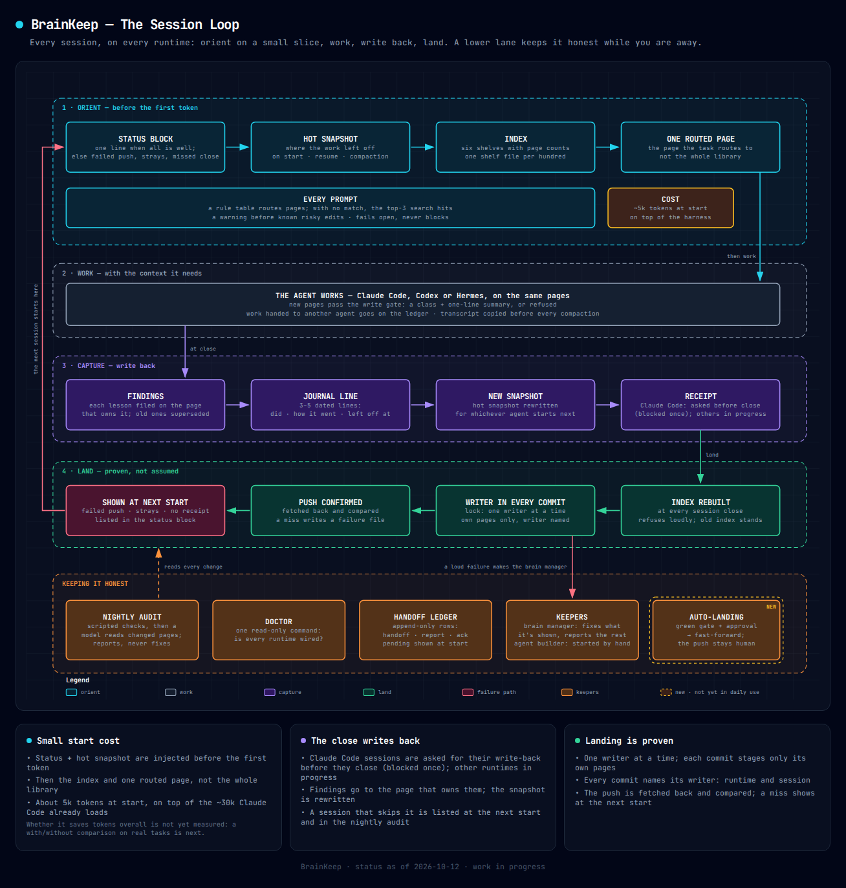
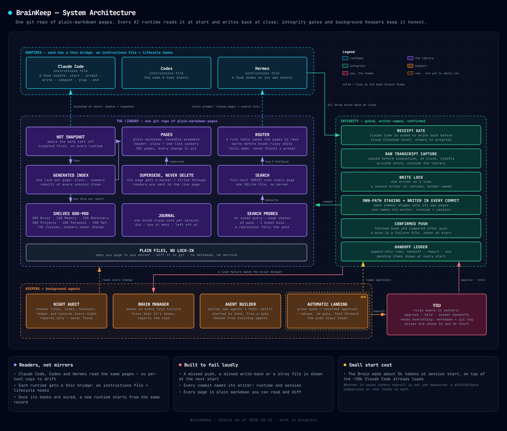

<p align="center">
  <picture>
    <source media="(prefers-color-scheme: dark)" srcset="docs/img/brainkeep-lockup-dark.png">
    
  </picture>
</p>

<p align="center">
  <b>One shared, plain-markdown memory for your AI agents. Agents run it, and you can read all of it.</b>
</p>

<p align="center">
  
  
</p>

> **Work in progress.** The architecture is published here; the code extraction is under way.
> This repo currently holds the thesis ([`THESIS.md`](THESIS.md)) and this README. **No code has
> been extracted yet.** Everything below describes a system I run every day in a private repo,
> and the [status table](#status--roadmap) says exactly what exists where.

→ Landing page: **[symes.com](https://symes.com)**

---

## What it is

**The problem:** AI agents forget between sessions and across tools. You re-explain, they re-read, and it's hard to see what they changed.
**Who it's for:** builders who run several AI agents (Claude Code, Codex, or Hermes, an open-source agent runtime) and want a memory they can read.

BrainKeep is a git repo of plain-markdown pages that these agents share. Each one reads it when a session starts and writes back to it when the session ends.
Background maintenance agents, called **Keepers**, audit it nightly and repair its machinery. A Keeper that lands finished work went onto the main branch on 2026-10-12 (the first thing it landed was itself); it isn't in daily use yet.
It's designed so that a person can open any page, any agent or any change and understand it.

BrainKeep will be that architecture with my own content stripped out. Today this repo has the thesis and this README; the extraction is under way.

## Why

Four claims, from [`THESIS.md`](THESIS.md). Every feature is checked against them.

1. **Efficient recall.** The right page reaches the agent without re-reading the whole library.
2. **It builds itself.** The Keepers maintain the library and build new agents.
3. **A human can read everything.** It's plain markdown in plain git, with nothing in an opaque store. You don't approve every change, but you can understand any of them.
4. **Nothing fails silently** is the design rule: anything pending, dropped, stale or superseded should be a file or a line you can open.

**The one rule:** if a change makes the library harder for a person to understand, it doesn't ship.

---

## What it does for you

### Agents maintain it
A nightly audit reads the pages that changed and reports contradictions, stale claims, broken links and pages that break the conventions. It reports and never fixes.
When something breaks loudly, a repair agent (the *brain manager*) wakes up, fixes what it's shown and reports the rest.

### Agents help you build, starting from the record
Every session opens on a short snapshot of where work stopped and a status block, so no agent starts cold.
The fixed reading order takes it to the one page its task needs.
A fenced *agent builder*, started by hand, writes new agents and their skills from a spec or from notes.

### Your data stays easy to track
- **Plain markdown in git.** You can read, diff and revert any page with tools you already have.
- **Every commit names its writer** in a `Brain-Writer: <runtime>/<session>` trailer.
- **Built to fail loudly.** A missed push, a missed write-back or a stray file is shown at the next start, and so is a handoff that's waiting. Recall helpers (router, search) fail open by design, so they never block a prompt.

### Small start cost: about 5k tokens
The Brain adds **about 5k tokens** at session start (the status block plus the `hot.md` snapshot).
That sits on top of the **~30k** Claude Code already loads before your first message: its own instructions, tool definitions and skill lists (the median across my last 235 sessions, from Claude Code's usage logs).
From there the agent opens the index and the one page the task needs, not the whole library.

The 5k is a character-based estimate (characters ÷ 4), not a tokenizer count.
**Whether BrainKeep saves tokens overall is not measured yet.** The test that would show it runs the same real tasks with and without the Brain and compares total tokens and whether the answer was right. That comparison is next.

### Works across runtimes
One library serves Claude Code, Codex and Hermes. Each runtime gets a thin instructions file and its own small set of hooks, and the libraries behind them are shared.
Once its hooks are wired, a new runtime starts from the same record.

---

## How it works

<p align="center">
  
</p>

*The session loop. A hook loads the snapshot (orient), the agent works, the session files what it learned (capture), and a commit that names its writer lands with a confirmed push (land). The next session, on any runtime, starts from the new snapshot.*

<p align="center">
  
</p>

*The architecture. Three runtimes reach one git library through thin per-runtime bridges. The Keepers work on the library from outside any session. Every lane writes plain files a person can open.*

### The bridge
Each runtime has a short **instructions file** (for example `CLAUDE.md` or `AGENTS.md`). It says where the library is and the order to read it in.
The file holds no persona and no copy of the rules, so it has nothing that can drift.
Each runtime also has **hooks**: Claude Code wires 6 event types (start, prompt, pre-write, pre-compaction, stop, end). Codex wires the same set, and Hermes maps 6 modes onto its own events.

### Reading order: snapshot → index → one page
1. **`hot.md`** is a "where we left off" snapshot that a hook injects on start, resume, clear and after compaction.
2. **`index.md`** is a shelf map that's regenerated at every session close. Nobody edits it by hand.
3. **One routed page** comes next, the page the task actually needs.

> Honest note: `hot.md` has a ~500-word target, but mine has grown to about 2,400 words and makes up most of the ~5k start cost. A length check for it landed on 2026-10-12.

### Shelves
Every file carries a Dewey-style **class** (000–900) in its frontmatter. That includes scripts and config, not only pages.
Class numbers are permanent, while shelf names can change. The class decides where a file is shelved, not its folder.
The index is two levels: `index.md` lists the hundreds with counts, and `index/NNN.md` gives one line per page (class, title, summary).
A shelf splits once it holds 25 files.

| Class | Shelf | Holds |
|---|---|---|
| 000 | Brain | How the memory works: snapshot, index, rules, adapters, guards, maintenance |
| 100 | Memory | Lessons, direction, concepts, syntheses, journal, transcripts, retired ideas |
| 200 | Machinery | Machines, agents, skills, scheduled jobs, gates, services |
| 300 | Projects | Work with a start, a spec and an end |
| 400 | Personal | The owner's own notes |
| 500–800 | *unassigned* | A new hundred is created only with a stated reason |
| 900 | Reference | External links and reading |

My library uses 6 hundreds and about fifty classes in all.

### Search, router and hazard routes
- **Search:** a SQLite full-text (BM25) index, kept outside the library and rebuilt after every index build. It needs no vector database and no server.
- **Router:** a prompt hook checks a rule table, which is content rather than code. If no rule matches, it names the top three search hits.
  The router fails open and has a kill switch, so it can never block a prompt.
- **Hazard routes:** "before you change X, read Y." If a prompt is about to edit hooks or a service unit, the agent is pointed to the lesson first.
  A nightly check proves that every pointer still resolves.

### Supersede and reclass
- **Supersede:** `brain-supersede OLD NEW "reason"` puts a banner on the old page and strikes it through in the index. Search and the router then send readers to the live page.
  It refuses cycles and missing targets, and a dangling pointer raises an alarm.
- **Reclass:** a tool proposes shelf moves as a table you can review. Applying them is a dry run unless you confirm. *(Built, not yet landed.)*

### Integrity
- **Write gate:** a page without `class:` and `summary:` is refused, and the agent is told which one is missing.
- **Write lock:** one writer at a time. A second writer is refused at once and told who holds the lock.
- **Own-path staging:** a session commits only the pages it wrote, plus the index. It never runs "add all".
- **Every commit names its writer** in a `Brain-Writer: <runtime>/<session>` trailer.
- **Confirmed push:** after pushing, the hook fetches and compares. A push that didn't land writes a failure file.
- **Receipt gate:** Claude Code sessions are asked for their write-back, a close note with a unique receipt, before they close (blocked once). A session that still skips it is listed at the next start. Other runtimes are in progress.
- **Raw transcript capture:** every transcript is copied to a private store before compaction and at close. A nightly sweep catches any that were missed, and a failed copy blocks the compaction.
- **Handoff ledger:** an append-only dated table of HANDOFF, REPORT, NOTE and ACK rows between agents and people. Rows are never edited.
  Every Keeper report starts with `OUTCOME: succeeded | failed | blocked`, and a checker refuses reports that are malformed or contradict themselves.

### The Keepers
| Keeper | Wakes on | Does |
|---|---|---|
| Night audit | Daily, plus a weekly report | Reads the pages that changed and reports; never fixes |
| Brain manager | Any loud failure | Works on the machinery (hooks, index, search, router); fixes what it's shown and reports the rest |
| Agent builder | Started by hand | Builds new agents and skills from a spec, inside a fence |
| Lander *(landed 2026-10-12, not yet in daily use)* | A green report plus an approval | Rebases, re-runs the gate and fast-forwards; never pushes |

An unattended Keeper runs with a tool allowlist, a 30-minute rate guard and a kill switch.
Before any re-wake, a liveness check answers **live**, **exited** or **unverifiable**. Only "exited" allows a re-run, and silence alone never triggers action.

---

## Features

✅ **live**: running daily in the private Brain · 🧪 **just landed**: on the main branch since 2026-10-12, not yet proven in daily use · ⏳ **next**: not built.
None of it is in this repo yet ([why](#status--roadmap)).

**Bridge and session loop**

| Feature | What it does | Status |
|---|---|---|
| One library, three runtimes | Claude Code, Codex and Hermes share one git folder | ✅ |
| Thin adapter | Gives the location and reading order, with no persona and no copied rules | ✅ |
| Snapshot on every start | `hot.md` injected on start, resume, clear and compaction | ✅ |
| Start-of-session status | Shows failed pushes, stray files, missing receipts and pending handoffs | ✅ |
| Receipt gate | Claude Code asks for the write-back before close (blocked once) | ✅ |
| Raw transcript capture | Saves copies before compaction and at close, plus a nightly sweep and a reader | ✅ |
| Doctor | Read-only check that every runtime is wired correctly | ✅ |

**Recall**

| Feature | What it does | Status |
|---|---|---|
| Dewey-style shelves | Every file is classed, the numbers are permanent, and shelves split at 25 | ✅ |
| Generated two-level index | Rebuilt at every session close; refuses to build on errors | ✅ |
| Full-text search | SQLite BM25 with no vector service | ✅ |
| Search probes | 64 saved query→page checks; 63 pass, 1 is a known miss | ✅ |
| Prompt router | Rule table plus top-3 search fallback; fails open | ✅ |
| Hazard routes | Points to the lesson before a risky edit | ✅ |
| Supersede | Old pages point to new ones, and search follows | ✅ |
| Reclass proposals | Reviewable shelf moves, dry run by default | 🧪 |

**Integrity**

| Feature | What it does | Status |
|---|---|---|
| Write gate | Refuses a page with no `class:` or `summary:` | ✅ |
| Write lock | One writer at a time; tells you who holds the lock | ✅ |
| Own-path, writer-named commits | Each session commits only its own pages, and each commit names its writer | ✅ |
| Confirmed push | Fetches and compares; a miss becomes a failure file | ✅ |
| Built to fail loudly | A missed push, a missed write-back or a stray file is shown at the next start | ✅ |

**Keepers**

| Feature | What it does | Status |
|---|---|---|
| Night audit | Daily and weekly reports that never fix anything | ✅ |
| Brain manager | Woken by failures; fixes what it's shown, reports the rest; allowlisted, with a kill switch | ✅ |
| Liveness verdict | Answers live, exited or unverifiable before any re-wake | ✅ |
| OUTCOME reports | Every Keeper report opens with its outcome and is checked | ✅ |
| Handoff ledger | Append-only record of handoffs, reports and acks | ✅ |
| Agent builder | Started by hand; builds new agents and skills inside a fence | ✅ |

**Landing and hygiene**

| Feature | What it does | Status |
|---|---|---|
| Parallel work folders | One worktree and branch per agent | 🧪 |
| Automatic landing | Lands after a green gate, an APPROVE row and no HOLD | 🧪 |
| One-command gate | Runs every suite, the probes and a dry index build | 🧪 |
| Snapshot hygiene | `hot.md` length check and a weekend-aware stale warning | 🧪 |
| Model-tiered orchestration | A planner sends builders out, each pinned to a model tier | ⏳ |

---

## Using it

A day with BrainKeep:

1. **Open any runtime**, whether that's Claude Code, Codex or Hermes.
2. **It already knows where you left off.** The snapshot and a one-line status come first. If something failed overnight, it says so.
3. **Work.** The router points the agent to the right page and warns it before risky edits.
4. **It files what it learned.** At close (asked for once on Claude Code) it writes a dated note (what we did / how it went / left off at), updates the snapshot and commits only its own pages. The commit names its writer, and the push is confirmed.
5. **The next session picks it up**, on any runtime.

**What you do:**
- **Read.** Read the status line, the weekly audit, and any page you're curious about.
- **Rule on handoffs.** Acknowledge them (✅). Approve them or hold them back with a recorded APPROVE or HOLD row (🧪).
- **Land.** Merging and pushing stay with you. Automatic landing (🧪) merges only work you approved, and it still never pushes.

---

## Build your own (today, before extraction)

You can copy the pattern by hand now. The sketches below are **illustrative**. They're not the BrainKeep code, which hasn't been published yet.

**1. A git repo of classed markdown.**

```markdown
---
class: 120
summary: Why recall goes by structure, not embeddings.
---
# Recall by structure
...
```

Keep it in something like `~/brain`. Write the shelf map down once (000 Brain, 100 Memory, …) and never renumber it.

**2. A snapshot page.** `hot.md` says where the work stopped, what's active and what's next. Keep it short (aim for ~500 words) and rewrite it at every close.

**3. A generated index.** Build it from the `class:` lines, skip the files it generates, and refuse to build if any other file has no class. That includes `hot.md`, journal notes and audit reports, so give each of them a `class:` line too:

```python
# build_index.py (illustrative)
import pathlib, re, sys
GENERATED = {"index.md"}                 # written by this script; never classed
rows, missing = [], []
for p in sorted(pathlib.Path(".").rglob("*.md")):
    if p.name in GENERATED:
        continue
    text = p.read_text()
    c = re.search(r"^class:\s*(\S+)", text, re.M)
    s = re.search(r"^summary:\s*(.+)", text, re.M)
    if not c:
        missing.append(str(p)); continue
    rows.append((c.group(1), p.stem, s.group(1) if s else ""))
if missing:
    sys.exit("unclassed: " + ", ".join(missing))   # loud, old index stands
pathlib.Path("index.md").write_text(
    "".join(f"- {c} [[{t}]]: {s}\n" for c, t, s in sorted(rows)))
```

**4. A thin instructions file** for each runtime (`CLAUDE.md`, `AGENTS.md`, …). It says where the library is, gives the reading order (snapshot → index → one page) and requires write-back at the end. Don't put the rules themselves in it.

**5. A start hook that injects the snapshot.** Claude Code adds a SessionStart hook's stdout to the agent's context:

```sh
#!/bin/sh
# session-start.sh (illustrative)
cd ~/brain || { echo "BRAIN: library missing"; exit 0; }
GIT_TERMINAL_PROMPT=0 timeout 10 git pull --ff-only -q || echo "BRAIN: pull failed, working from the local copy"
for f in failures/*; do [ -e "$f" ] && echo "BRAIN FAILURE: $f"; done
echo "Read order: hot.md (below) -> index.md -> the one page your task needs."
cat hot.md
```

**6. A capture step with a receipt.** A Stop hook blocks once until the session has written its close note:

```python
#!/usr/bin/env python3
# receipt_gate.py (illustrative)
import json, sys, pathlib
ev = json.load(sys.stdin)
if ev.get("stop_hook_active"):
    sys.exit(0)                       # asked once already
sid = ev["session_id"]
notes = (pathlib.Path.home() / "brain" / "journal").glob("*session-close*.md")
if not any(sid in n.read_text() for n in notes):
    print(json.dumps({"decision": "block", "reason":
        f"Write journal/<date>-session-close.md (what we did / how it went / "
        f"left off at), update hot.md, and include receipt {sid}."}))
```

Claude Code fires Stop after every turn, so as written this asks after each reply until the note exists. Keep a per-session marker file if you want it to ask only once.

**7. An end hook that commits and confirms.** It takes a lock, stages only its own paths, names the writer in the commit, pushes and checks the push:

```sh
#!/bin/sh
# session-end.sh (illustrative)
set -u
SID=$(jq -r '.session_id // empty')     # hook input arrives as JSON on stdin
[ -n "$SID" ] || { echo "no session_id on stdin" >&2; exit 1; }
cd ~/brain || exit 1
mkdir -p failures
exec 9>.git/brain.lock
flock -n 9 || { echo "another writer holds the lock" >&2; exit 75; }   # util-linux
python3 build_index.py || { echo "index refused" > "failures/index-$(date +%s)"; exit 1; }
git add -- index.md
[ -f ".written-$SID" ] && tr '\n' '\0' < ".written-$SID" | xargs -0 git add --
git commit -q -m "session close" --trailer "Brain-Writer: claude/$SID"
if ! { git push -q && git fetch -q &&
       [ "$(git rev-parse HEAD)" = "$(git rev-parse @{u})" ]; }; then
  echo "push not confirmed" > "failures/push-$(date +%s)"   # shown at next start
fi
```

A pre-write hook can append every path the agent writes to `.written-<session_id>` (git-ignored), and it can refuse pages that have no `class:` or `summary:`.

**8. A nightly read-only audit.** Have a timer run a script that checks for broken links, unclassed files and `hot.md` length, then writes a dated report page. The script should never edit pages:

```cron
0 4 * * *  cd ~/brain && ./audit.sh > maintenance/$(date +\%F).md
```

That's the core loop. The Keepers, the router and the ledger come later and are built on top of it.

---

## Status & roadmap

| Piece | Private Brain | This repo |
|---|---|---|
| Shared library across Claude Code, Codex, Hermes | ✅ daily use | ⏳ not extracted |
| Snapshot → index → page reading order | ✅ | ⏳ |
| Shelves, generated index, search, router | ✅ | ⏳ |
| Write gate, lock, writer-named commits, confirmed push | ✅ | ⏳ |
| Receipt gate, transcript capture, status block | ✅ | ⏳ |
| Night audit, brain manager, OUTCOME reports, ledger | ✅ | ⏳ |
| Supersede, hazard routes, doctor | ✅ | ⏳ |
| Reclass, worktrees, automatic landing, snapshot lint | 🧪 just landed | ⏳ |
| Content-free skeleton you can clone | n/a | ⏳ next |
| Installer / first-run setup | n/a | ⏳ not started |
| Shelves a stranger can run | n/a | ⏳ open problem |

**Where it stands, in numbers.** About 760 tests passed in five suites at the latest gate run, on the private branch. Of the 64 search probes, 63 pass and 1 is a known miss. It serves 3 runtimes and holds about 380 pages on 6 shelves.

**Next steps**
1. **Strip personal content out to leave a skeleton.** That means the shelves, empty pages and example routes, with none of my material.
2. **Publish the hooks, CLIs and tests** for each runtime, with the suites that prove them.
3. **Write an installer** that wires the hooks into a runtime and runs the doctor.
4. **Make the shelves teachable.** This is the open problem from [`THESIS.md`](THESIS.md): today only their author can run the class system well. The goal is that the Keepers file pages themselves, and anyone can read a shelf and see why each page sits there.

Watch or star the repo if you want to see the extraction land.

### What it is not
- **Not a vector database.** Recall goes by structure (snapshot → index → page) plus full-text search, not embeddings.
- **Not a hosted service.** It's a git repo and some hooks on your own machine.
- **Not finished.** See above.

---

## Acknowledgements

Mechanisms adapted from **MemPalace** and **Orca**.

---

<p align="center">
  Built by <a href="https://symes.com/cv/">James Symes</a> with Claude.
</p>
